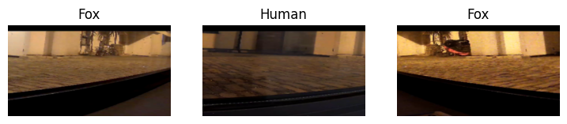
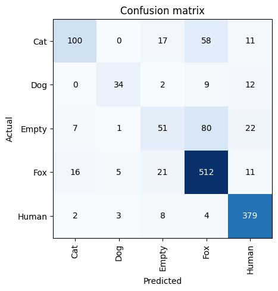

# Dataset Creator

### Wildlife Dataset Preparation & Classification

**From camera recordings to a trained wildlife classifier.**

Python · Jupyter · OpenCV · NumPy · fastai / PyTorch · Matplotlib

[Overview](#overview) · [Features](#features) · [How it works](#how-it-works)

## Overview

Dataset Creator is a collection of notebooks for preparing wildlife image datasets from video and training a classifier. It explores how to select useful frames from noisy nighttime footage, then fine-tunes a ResNet-34 model to distinguish cats, dogs, foxes, humans and empty scenes.

The project supports [Fox Spy](https://github.com/Nosohvost/Nocturnal-Wildlife-Classifier), a desktop application that records wildlife sightings and visualises their activity.

## Features

- **Frame extraction**: sample video at configurable intervals, resize frames and crop the camera view.
- **Motion-based selection**: compare frames using mean squared error to select images with meaningful changes.
- **Dataset preparation**: process folders of recordings and save selected frames as PNG files, including background examples for the empty class.
- **Image processing experiments**: compare blur filters, inspect frame differences, and explore thresholding, contours and background subtraction.
- **Transfer learning**: load labels from dataset folders, apply image augmentation, fine-tune ResNet-34 with fastai, and export a model.

## How it works

**Video recordings -> Frame extraction -> Frame selection & cropping -> Labelled image folders -> Model training -> Evaluation & export**

The preparation notebooks use OpenCV and NumPy to sample and compare frames. The training notebook reads a folder-labelled dataset, creates a reproducible random training/validation split, and fine-tunes a pretrained ResNet-34 classifier. Saved outputs include sample images, training metrics and a confusion matrix.

<em>The notebook's saved evaluation output shows where the classifier succeeds and which classes it confuses.</em>

## Notebooks

| Notebook | Role |
| --- | --- |
| [`main.ipynb`](main.ipynb) | Exploratory frame extraction, motion detection, denoising and object localisation |
| [`second_attempt.ipynb`](second_attempt.ipynb) | Configurable frame preparation and batch processing |
| [`NN_creator.ipynb`](NN_creator.ipynb) | ResNet-34 training, evaluation and model export |

Sample footage and images are included in `sample_videos/`, `sample_frames/` and `sample_noise/`. The training notebook expects a separate `dataset/` directory with one folder per class.
